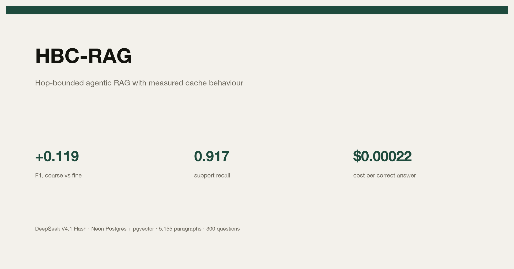
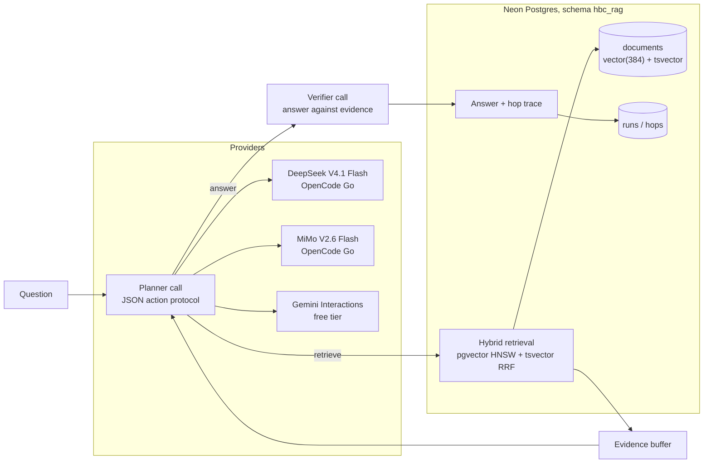

# HBC-RAG



Hop-bounded agentic RAG with measured cache behaviour, scored deterministically and paired by question.

The study asks one question: does retrieval granularity, one chunk per hop versus four, change answer quality, evidence coverage, cost and latency in a multi-hop agent? It runs two policies that differ only in hop size, on the same corpus, prompt, model and temperature, over HotpotQA and a MuSiQue holdout, then repeats on a second model family.

## Results

HotpotQA, 150 questions, DeepSeek V4.1 Flash:

| policy | EM | F1 | support recall | hops | p50 | p95 | cost |
|---|---|---|---|---|---|---|---|
| fine, 1 chunk per hop | 0.427 | 0.588 | 0.620 | 1.43 | 4.07s | 28.3s | $0.0160 |
| coarse, 4 chunks per hop | 0.560 | 0.707 | 0.917 | 1.11 | 2.62s | 27.6s | $0.0186 |

F1 +0.119, 95% CI +0.057 to +0.181. McNemar chi2 13.88, p < 0.001. Cost per correct answer drops from $0.000250 to $0.000221.

HotpotQA, 100 questions, MiMo V2.6 Flash, same protocol:

| policy | EM | F1 | support recall | hops | p50 | cost |
|---|---|---|---|---|---|---|
| fine | 0.400 | 0.559 | 0.695 | 1.63 | 9.65s | $0.0126 |
| coarse | 0.470 | 0.683 | 0.925 | 1.14 | 4.31s | $0.0152 |

The direction replicates on a second family: coarser hops raise F1 by 12 points and evidence recall by 23 points while using fewer hops and less wall time.

MuSiQue, 50 held-out questions, DeepSeek: accuracy ties (F1 +0.011, CI -0.077 to +0.097), evidence recall rises from 0.337 to 0.527 and p95 falls from 27.5s to 12.3s.

## Novelty: what the cache does

Two measurements the quality table cannot explain.

**Gemini Interactions, stateful chains.** For a fixed prefix of about four thousand tokens, the cached span stays flat near 4,070 tokens at every hop size tested, from 200 to 3,000 new tokens. Cache share therefore falls as hops grow, because new tokens are always billed fresh. No 2,050-token incremental threshold appears on Gemini 3.5 Flash Lite; Gemini 4 Hydrogen returned 503 during the test window.

| new tokens in hop | prompt tokens | cached | share |
|---|---|---|---|
| 200 | 5,678 | 2,032 | 35.8% |
| 800 | 6,255 | 4,067 | 65.0% |
| 1,500 | 6,946 | 4,070 | 58.6% |
| 2,100 | 7,541 | 4,072 | 54.0% |
| 3,000 | 8,449 | 4,074 | 48.2% |

**OpenCode Go, DeepSeek, identical 19k-token prefix.** Five of six calls hit the prefix cache, but billed allowance ranged from $0.000043 to $0.00174 for identical input, a 40x spread caused by gateway routing. Cache locality, not prompt shape, dominates cost in that path.

Full report with figures: `reports/report.html`, or `/report/` when the API is running.

## Architecture



Two independent packages meet at one protocol, so the harness can test any retrieval system and the RAG works without the harness:

```python
class SystemUnderTest(Protocol):
    async def ask(self, question: str, *, deadline_ms: int | None = None) -> dict: ...
```

## Technology stack

- Python 3.12, `uv` workspace
- Neon Postgres, pgvector HNSW, full-text search, pooled connections
- `fastembed` bge-small-en-v1.5, local ONNX embeddings
- FastAPI, `httpx` async
- DeepSeek V4.1 Flash and MiMo V2.6 Flash through OpenCode Go
- Gemini Interactions API for the cache threshold experiment
- React and Vite dashboard
- pytest, ruff, GitHub Actions

## Repository layout

- `packages/rag-core`: retrieval, hop policies, providers, pipeline
- `packages/harness`: open-loop load generator, metrics, scoring, statistics
- `apps/api`: FastAPI wrapper, HTTP system under test
- `web`: dashboard for health and recorded runs
- `scripts`: corpus build, evaluation grid, cache probes, report
- `docs/method.md`: protocol, metrics, threats to validity
- `reports`: generated report, figures, cache data

## Quick start

```bash
uv sync --all-packages
npm --prefix web install
neon link && neon deploy           # Neon project, bucket assets
uv run python scripts/neon_smoke.py
uv run python scripts/build_corpus.py --hotpot 300 --musique 150
uv run uvicorn app.main:app --app-dir apps/api --port 8000
```

Credentials live in `keys.env` at the repo root, chmod 600 and gitignored, and in `.env.local` for the Neon connection. `uv run python scripts/check_keys.py` reports which providers are live without printing them.

## Honest framing

- One seed per dataset and model. Deltas under two points are noise until replicated.
- MuSiQue uses 50 questions, so its intervals are wide.
- Concurrency is deliberately not claimed. Repeat load runs at one request per second gave 100 percent and 36 percent goodput on identical settings, so run-to-run variance exceeds the effect. The harness ships, the conclusion does not.
- p95 includes gateway 429 retries, so it measures the served path.
- The Gemini threshold experiment could not run on Gemini 4 Hydrogen, the model the documented 2,050-token rule applies to.

## Status

Complete for this pass. Further work: second seed on both models, a larger MuSiQue holdout, and a calibrated judge for paraphrase-equivalent answers only.

License: Apache-2.0.
