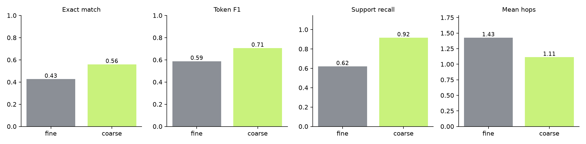
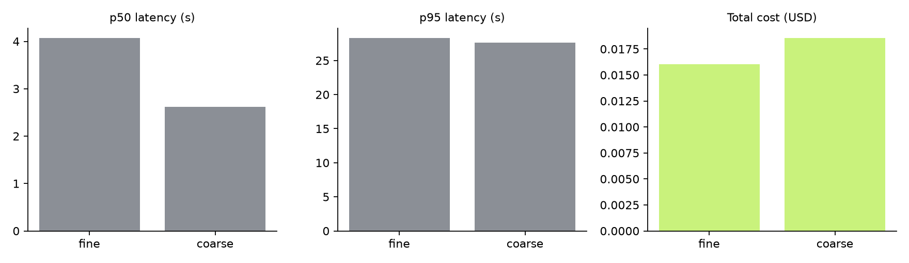
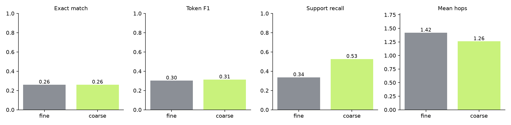
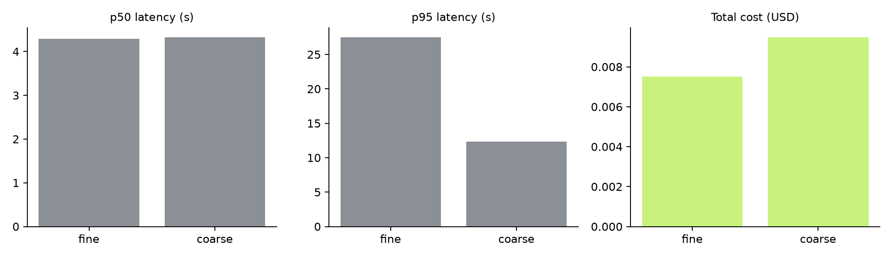

## hotpotqa

| policy | n | em | f1 | support_recall | hops_mean | cache_hit_rate | cost_usd | latency_p50_ms | latency_p95_ms |
|---|---|---|---|---|---|---|---|---|---|
| fine | 150 | 0.427 | 0.588 | 0.620 | 1.43 | 8.7% | $0.01602 | 4.07s | 28.32s |
| coarse | 150 | 0.560 | 0.707 | 0.917 | 1.11 | 2.1% | $0.01857 | 2.62s | 27.63s |

Paired over 150 questions: coarse minus fine F1 +0.119 (95% CI +0.057 to +0.181); McNemar EM chi2 13.88, p 0.000; cost delta $+0.000017 per question.

## musique

| policy | n | em | f1 | support_recall | hops_mean | cache_hit_rate | cost_usd | latency_p50_ms | latency_p95_ms |
|---|---|---|---|---|---|---|---|---|---|
| fine | 50 | 0.260 | 0.302 | 0.337 | 1.42 | 0.0% | $0.00751 | 4.30s | 27.51s |
| coarse | 50 | 0.260 | 0.313 | 0.527 | 1.26 | 0.0% | $0.00949 | 4.33s | 12.34s |

Paired over 50 questions: coarse minus fine F1 +0.011 (95% CI -0.077 to +0.097); McNemar EM chi2 0.25, p 0.617; cost delta $+0.000039 per question.

## offered load

| offered load | requests | p50 | p95 | goodput at 8s |
|---|---|---|---|---|
| 1 qps | 44 | 2.85s | 26.02s | 84.1% |
| 2 qps | 94 | 10.53s | 76.36s | 47.9% |
